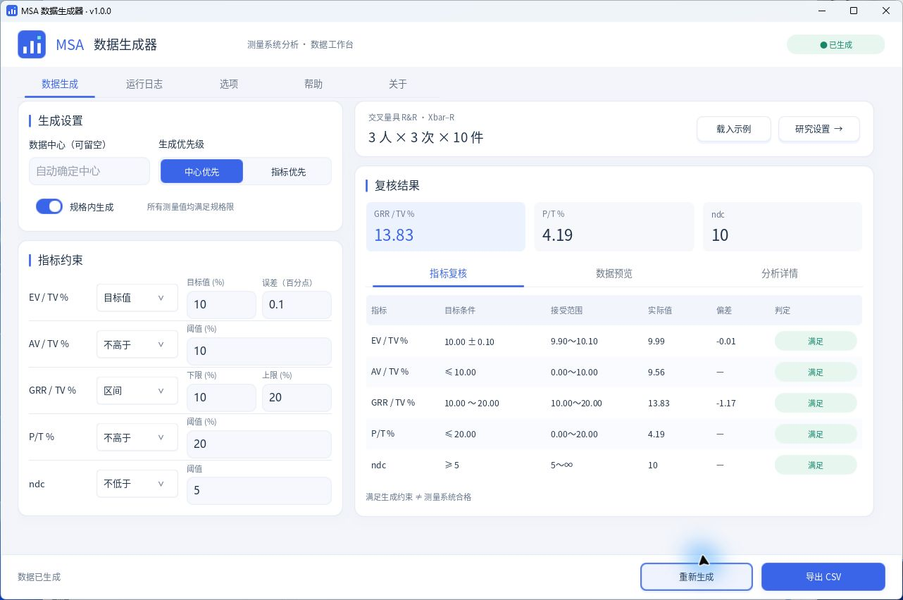

<div align="center">
  
  <h1>MSA 数据生成器</h1>
  <p>交叉量具 R&amp;R 研究 · 数据生成 · 统计复核 · 多软件 CSV 导出</p>
  <p><strong>v1.0.0</strong> · Windows x64 · C++17 / EUI-NEO · <a href="LICENSE">MIT License</a></p>
  <p><a href="https://github.com/print-yuhuan/Msa-Data-Generator/releases/tag/v1.0.0">下载运行包</a> · <a href="docs/使用说明.md">使用说明</a> · <a href="docs/README.md">文档中心</a></p>
</div>

MSA 数据生成器用于构造满足指定指标约束的交叉量具 R&R 测量数据，并按 **Xbar-R（均值极差法）** 或 **ANOVA（方差分析法）** 复核结果。提供 Windows 桌面界面与命令行工具，可用于方法学习、软件对标和流程验证。

生成结果属于模拟数据，不能代替真实测量记录。满足生成约束也不代表实际测量系统合格。

**当前发布内容（2026-10-30）**：v1.0.0 包含结果图表、图片/PDF 导出、AI 助手及七项代码审查修复，Windows x64 运行包与当前标签源码对应。图表和 AI 的验证范围分别见 [图表专项验证](docs/图表专项验证.md)、[AI 专项验证](docs/AI专项验证.md)；本次完整回归见 [修复与验证报告](docs/代码审查修复与回归.md)。历史外部软件实测只证明各报告列明的数据、参数与构建。



## 功能概览

| 能力 | 支持范围 |
| --- | --- |
| 研究设计 | 2 或 3 名操作员、2 或 3 次重复测量、5～10 件部件，共 24 种平衡交叉设计 |
| 分析方法 | Xbar-R；平衡交叉双随机效应 ANOVA，支持交互项自动判断、保留或移除 |
| 指标约束 | EV/TV、AV/TV、GRR/TV、P/T、ndc；支持不约束、目标值、区间、上限和下限条件 |
| 生成设置 | 数据中心、生成优先级、严格规格、随机种子、小数位数与搜索预算 |
| 分析设置 | 研究变异倍数、独立分析容差、历史标准差与均值、过程变异来源；ANOVA 误分类概率及方差分量置信限 |
| CSV 导出 | 默认宽表；Minitab、SPSS、JMP 19、Origin、MATLAB 五种统一长表预设 |
| 运行顺序 | 标准顺序、全部随机化、操作员内部随机化；独立排序种子、可选操作员随机顺序与 StdOrder |
| 自动命名 | 时间、研究参数、实际指标与版本号变量；同名文件自动追加序号或按配置覆盖 |
| CLI | 覆盖研究、生成、分析和 CSV 业务配置；命令行参数优先于 JSON；支持已有 CSV 分析和 JSON 报告 |
| 结果可视化 | 七类 MSA 图表、操作员分面与控制限标注；独立草稿、应用/撤销、外观与坐标范围编辑 |
| 可视化导出 | PNG/JPEG 单图或多图组合，以及高分辨率图像型 PDF；同名自动追加序号 |
| AI 助手 | 自然语言生成、多轮参数调整与失败诊断；生成和评价均使用严格 JSON；解读当前结果或导入 CSV，数值以本机计算为准 |
| AI 服务配置 | DeepSeek 预设、自定义 OpenAI 兼容接口、模型列表选择、连接测试、DeepSeek 余额查询与两类系统提示词；API Key 由 Windows DPAPI 加密保存 |
| 桌面体验 | 七个功能页面、宽窄布局、键盘导航、后台任务与取消、固定状态栏反馈 |

修改导出目录、文件名、格式或运行顺序无需重新生成数据。重新生成期间保留已有结果供查看；同一配置下取消或失败后可继续使用上次成功结果。修改影响数据或统计的配置会使旧结果失效。

新增功能操作、配置和验证边界见 [结果可视化与 AI 助手](docs/结果可视化与AI助手.md)，结构化字段、取消及手动重试见 [AI 协议与错误恢复](docs/AI协议与错误恢复.md)。图表编辑/导出和 AI 请求目前通过 GUI 提供，暂未提供对应 CLI 参数。AI 连接配置独立于研究 JSON；现有 CLI 的研究、生成、分析和 CSV 参数含义不变。

## 下载与运行

1. 在 [v1.0.0 发布页](https://github.com/print-yuhuan/Msa-Data-Generator/releases/tag/v1.0.0) 下载 `MSA_Data_Generator_v1.0.0_Windows_x64.zip`。
2. 解压到可写目录，双击 `msa_generator.exe`。
3. 在帮助页选择“填入示例设置”，或在“选项 → 研究设置”填写研究设计与规格，再生成数据。
4. 在“选项 → 导出设置”配置 CSV 格式、目录、文件名和运行顺序，然后导出。

这是**免安装便携运行包**。主程序已内嵌中文字体、图标和窗口清单，可单文件启动；不依赖 Python、Excel、Minitab 或外部字体文件。当前验证平台为 Windows x64，图形环境需支持 OpenGL 3.3 Core。默认窗口居中打开，并按 DPI 和工作区大小调整。

运行包同时包含 CLI、回归验证工具、示例、说明文档及许可证。`licenses/` 属于分发许可材料，不是 GUI 启动依赖；再分发时请保留适用的版权和许可声明。源代码可从本仓库或 v1.0.0 标签获取，Release 仅上传上述 Windows 运行包，不另外上传源码 ZIP。

### 命令行示例

在解压后的运行包目录打开 PowerShell：

```powershell
.\msa_cli.exe --help
.\msa_cli.exe --license
.\msa_cli.exe --no-config --lsl 9 --usl 11 --seed 123 --csv-format minitab --run-order all --run-seed 321 --store-standard-order true --output ".\data.csv" --report ".\result.json"
```

`--seed` 控制测量数据，`--run-seed` 独立控制导出行序。显式输出路径已存在时，需更换路径或使用 `--overwrite`。完整参数、默认值与配置优先级见 [CLI 使用说明](docs/使用说明.md#cli) 和 [配置参考](docs/配置参考.md)。

## 分析与互操作边界

- **统计口径**：EV、AV、GRR、PV、TV 均以标准差（1σ）表示；研究变异百分比为对应标准差占总标准差的百分比。研究变异倍数默认 6，P/T 使用所选分析容差；标准差比例与方差贡献率不可混用。
- **导出映射**：五种长表共用 `Operator,Part,Trial,Measurement`，可增加首列 `StdOrder`。仅重排完整测量记录，保留真实重复测量编号、测量值和小数精度；同一研究的五种格式共用同一排列。
- **对标条件**：比较外部软件时，需对齐数据、模型、交互项处理、负方差处理、研究变异倍数、容差和历史过程设置。EMS、REML、Bayesian 等估计方法不能直接作为同一结果比较。
- **验证范围**：仓库包含 Minitab 基准及五软件实测记录，也记录了差异项和未支持项。报告结论只适用于列明的数据、软件版本和参数组合，不表示所有软件的默认输出均一致。

详见 [Minitab 导入与对标](docs/Minitab导入与对标.md)、[ANOVA 设计与五软件对标](docs/ANOVA设计与五软件对标.md) 和 [GUI 参数兼容与对标记录](docs/GUI参数兼容与对标进度.md)。

## 从源码构建

需要 CMake 3.24 或更高版本、Visual Studio C++ 工具链和 Windows SDK。构建所需依赖、中文字体和许可已随仓库保留，无需下载子模块或在线获取依赖。

```powershell
cmake -S . -B build -A x64 -DMSA_BUILD_RENDER_TESTS=ON
cmake --build build --config Release --parallel 4
ctest --test-dir build -C Release --output-on-failure
```

生成的桌面程序与 CLI 位于 `build/Release/`。`MSA_BUILD_RENDER_TESTS=ON` 启用需要桌面 OpenGL 环境的界面、渲染和内嵌资源回归；该选项默认关闭。仅构建内核、CLI 与非图形测试时可设置 `-DMSA_BUILD_GUI=OFF`，其他平台尚未完成实测。

### 测试与打包

完整 Windows 回归需要本地 Git、PowerShell 和 Python 3，渲染回归还需要可用的桌面 OpenGL 环境。这些测试工具不是发布程序的运行依赖。

| 验证类别 | 内容 |
| --- | --- |
| 统计内核 | 192 组 Minitab Xbar-R 基准、24 种研究设计，以及 ANOVA 和分析选项回归 |
| CSV 与运行顺序 | 六种格式、精度、完整记录映射、种子复现、StdOrder 和统计结果不变性 |
| 命令行与发布 | 参数优先级、输入校验、报告、内嵌许可、包内文件及证据绑定 |
| 界面与资源 | 布局和状态流转、键盘操作、滚动像素一致性、中文字体完整性 |

详细测试命令、实测记录和未验证边界见 [验证说明](docs/验证报告.md)。本机外部软件对标脚本不属于常规 CTest，不是程序运行依赖。

七项代码审查问题的修复与新增回归见 [修复记录](docs/代码审查修复与回归.md)，字体容量和淘汰策略见 [字体图集设计](docs/字体图集设计与验证.md)。源码归档按 [源码打包规则](docs/源码打包规则.md)收集当前工作区文件并遵循 Git 忽略规则；不会把整个目录无差别加入压缩包。

```powershell
.\scripts\package.ps1 -BuildDirectory build
```

打包脚本验证包内二进制、许可文件及测试证据，生成 `dist/MSA_Data_Generator_v1.0.0_Windows_x64.zip` 和 SHA-256 校验文件。同版本目录存在时会拒绝覆盖，应先保留或移走旧产物。构建及打包产物由 `.gitignore` 排除。

## 文档与项目结构

| 入口 | 内容 |
| --- | --- |
| [文档中心](docs/README.md) | 按使用、配置、开发和验证场景组织全部说明 |
| [使用说明](docs/使用说明.md) / [示例配置](examples/README.md) | GUI 操作、CLI 参数、导出与错误处理 |
| [结果可视化与 AI 助手](docs/结果可视化与AI助手.md) | 新增图表编辑、图片/PDF 导出、AI 服务与多轮工作流程；分别说明验证边界 |
| [AI 协议与错误恢复](docs/AI协议与错误恢复.md) | 生成与评价的严格 JSON 契约、上下文限制、密钥保存与手动重试 |
| [界面设计规范](docs/界面设计规范.md) / [界面验收](docs/界面验收.md) | 视觉规范、控件状态、布局与实测边界 |
| [单文件验证](docs/单文件运行验证.md) / [字体性能验证](docs/字体优化与性能验证.md) | 内嵌资源、字形完整性与性能测量 |
| [MIT 许可说明](docs/许可证与署名说明.md) / [第三方声明](THIRD_PARTY_NOTICES.md) | 项目授权范围、第三方许可与来源 |

```text
src/          统计内核、命令行、桌面界面与平台适配
resources/    字体、图标及 Windows 资源源文件
third_party/  固定版本的构建依赖
patches/      第三方集成补丁记录
scripts/      构建、验证与打包脚本
tests/        回归测试、固定基准与 CSV 参考
examples/     示例配置
docs/         使用说明、设计规范与验证记录
licenses/     第三方许可证（打包时另加入项目许可副本）
```

产品版本统一来自 `CMakeLists.txt` 的 `PROJECT_VERSION`。依赖来源与哈希见 [dependencies.lock.json](dependencies.lock.json)。

## 许可证与作者

Copyright © 2026 **print-yuhuan**。本项目自有代码、文档、图标及其他原创资源采用 [MIT License](LICENSE)，允许商业使用、修改和再分发；软件副本或重要部分应保留版权声明及许可声明。MIT 不要求公开衍生项目源码，也不要求在产品界面展示作者或仓库地址。软件按许可证约定以“原样”提供，不附带担保。

[NOTICE](NOTICE) 提供作者和仓库来源信息，不增加 MIT 条款之外的条件。第三方代码、字体及资源继续适用各自许可证，详见 [第三方声明](THIRD_PARTY_NOTICES.md)。

项目仓库：[print-yuhuan/Msa-Data-Generator](https://github.com/print-yuhuan/Msa-Data-Generator)。欢迎通过 [Issues](https://github.com/print-yuhuan/Msa-Data-Generator/issues) 提交可复现的问题、参数配置和预期结果；请勿附带个人数据或访问凭据。
