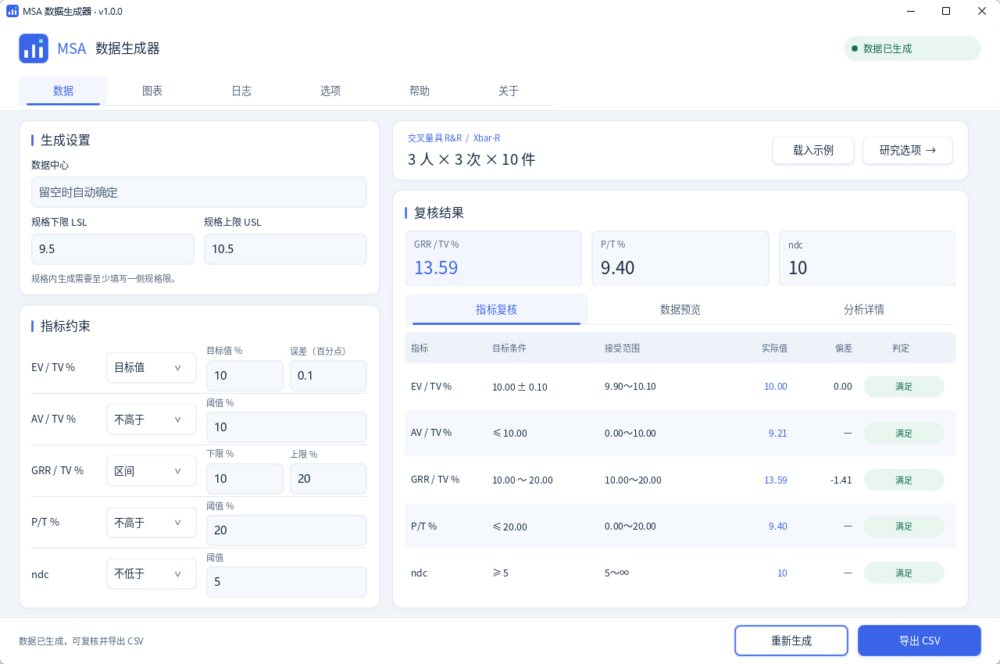

<div align="center">
  <h1>MSA 数据生成器</h1>
  <p>生成交叉量具 R&amp;R 模拟数据，复核统计指标，导出测量记录。</p>
  <p><strong>Windows x64</strong> · v1.0.9 · <a href="LICENSE">MIT 许可证</a></p>
  <p>
    <a href="https://github.com/print-yuhuan/Msa-Data-Generator/releases/download/v1.0.9/MSA_Data_Generator_v1.0.9_Windows_x64.zip"><strong>下载 Windows x64</strong></a>
    · <a href="#快速开始">快速开始</a>
    · <a href="docs/README.md">文档中心</a>
  </p>
</div>

<p align="center">
  <a href="docs/ui-preview.png">
    
  </a>
</p>
<p align="center"><sub>数据页 · Xbar-R · 3 名操作员 × 3 次重复测量 × 10 个部件</sub></p>

## 快速开始

1. 下载 [Windows x64 便携包][windows-zip]，解压后双击 `msa_generator.exe`。
2. 在**数据**页点击**载入示例**，再点击**生成数据**。
3. 在右侧查看**指标复核**、**数据预览**和**分析详情**，或切换到**图表**页。
4. 在**选项 → 文件**选择格式与运行顺序，然后返回数据页点击**导出数据**。

桌面程序内嵌中文字体和图标，可免安装运行，图形环境需支持 **OpenGL 3.3 Core**。压缩包还包含 CLI、示例配置、回归验证工具和许可证。[发布页][release] · [SHA-256 校验文件][checksum]

> [!NOTE]
> 生成结果适用于方法学习、软件对标和流程验证。测量系统的实际判定须依据真实测量记录。

## 主要功能

| 能力 | 支持范围 |
| --- | --- |
| 研究与生成 | 2～3 名操作员、2～3 次重复测量、5～10 个部件，共 24 种平衡交叉设计。提供十种部件取样方案，可在上下规格限之间随机取样，也可选择分层随机、正态分位或双批取样等方案。可按需设置最低跨度和近似正态筛选。[取样设置](docs/使用说明.md#部件取样与跨度) |
| 统计复核 | 支持 **Xbar-R（均值极差法）** 与 **ANOVA（方差分析法）**。可设置 EV/TV、AV/TV、GRR/TV、P/T、ndc 的目标值、区间或上下限。 |
| 分析选项 | 支持研究变异倍数、独立分析容差和历史过程参数。ANOVA 另支持交互项设置、误分类概率和方差分量置信限。 |
| 图表 | 提供七类 MSA 图表，支持操作员分面、控制限、坐标与外观编辑，可导出 PNG、JPEG、PDF 或矢量 SVG。 |
| 数据文件 | 可导入和导出 CSV 或 Excel 工作簿（XLSX）。提供默认宽表及 Minitab、SPSS、JMP、Origin、MATLAB 五种长表预设。可设置运行顺序、独立排序种子、`StdOrder` 和文件名模板。 |

数据生成、统计分析、图表绘制和文件导出均在本机完成。桌面程序和 CLI 共用统计内核与配置规则。统计口径及外部软件的参数差异见 [Minitab 导入与对标](docs/Minitab导入与对标.md)和 [ANOVA 对标记录](docs/ANOVA设计与五软件对标.md)。

## v1.0.9 更新

多表 XLSX 的工作表选择和六行无姓名数据的研究设计选择，都在图表页的同一位置完成。选表后点击「继续」。仅当数据行需要分组时，才显示两张研究设计卡片，列出 A、B、C 对应的行号。可点「上一步」改选工作表，或取消并保留当前数据和图表编辑。[查看两个面板及分组示例](docs/结果可视化.md#入口与数据来源)

## v1.0.8 更新

- 打开「选项 → 图表」，可以选择默认风格或 Origin 风格。默认风格沿用程序的蓝色主色，Origin 风格保留 v1.0.7 的图表配色。两套风格都能编辑，切换后再切回，可以接着使用各自的修改。
- 图表导出设置集中在同一标签，支持选择格式、单图宽度、单图或组合、排列列数和图表清单。设置后回到图表页，点击底栏的「导出图表」。[图表操作说明](docs/结果可视化.md)

## v1.0.7 更新

- 图表页参照同一份研究在 OriginPro 中生成的图形，重新设置了坐标轴、刻度、系列点形和直方柱。交互图用颜色和形状同时区分操作员。[查看同数据对照图](docs/图表专项验证.md#originpro-2026b-实测)
- 打开「编辑图表」可实时预览草稿，调整纵轴刻度、数据点形状、图例位置或直方图分箱，确认后应用。单图和组合图均可导出保留文字与图元的 SVG。[图表编辑与导出](docs/结果可视化.md)
- 下载同一份测量数据、可编辑的 Origin 工程以及两套程序的配套图，复核交互均值和方差分析。[Origin 对标样例](https://github.com/print-yuhuan/Msa-Data-Generator/releases/download/v1.0.7/MSA_Origin_Reference_v1.0.7.zip)

## v1.0.6 更新

- 导入没有操作员名称的六行纯数值宽表时，程序会询问本次研究是「2 人各测 3 次」还是「3 人各测 2 次」。取消后保留当前数据和图表。再次导入时可以重新选择。
- 命令行导入这类 CSV 或 XLSX 时，使用 `--replicates 3` 或 `--replicates 2` 指定本次设计。省略参数会显示用法提示，已保存的默认设置继续用于生成数据。[导入说明](docs/结果可视化.md#入口与数据来源)

## v1.0.5 更新

- 在「图表 → 导入数据」直接打开 CSV 或 XLSX。程序从文件或所选工作表识别操作员姓名、人数、部件数和重复次数，图表、重新分析及方法对比报告沿用这份研究的人员信息。
- 「选项 → 研究」里的默认操作员继续用于生成新数据。命令行使用 `--input` 即可分析文件，标准输出和 JSON 报告都会给出识别到的研究设计。[数据导入说明](docs/结果可视化.md#入口与数据来源)

## v1.0.4 更新

- 在「选项 → 研究 → 研究设计」底部可填写三位操作员的默认名称。每个位置可单独留空，依次使用 A、B、C。选择两人时第三个输入框变暗，切回三人即可继续使用原先填写的名称。
- 数据预览、CSV/XLSX、图表和方法对比报告均使用本次研究的操作员名称。命令行也可通过 `--operator-a`、`--operator-b`、`--operator-c` 指定名称。

## v1.0.3 更新

- 新增随机取样、正态分位、低值加密、高值加密和双批取样。随机取样按部件独立抽取规格区间内的基础尺寸，同一部件的重复测量共用该尺寸。
- 部件取样下拉框、帮助和命令行按相同顺序列出十种方案。旧配置按方案标识恢复，原有五种方案保持既有的固定种子结果。
- 生成后可在分析详情查看本次方案与实际部件均值跨度。设置双侧规格时，同时显示跨度占规格宽度的百分比。

## v1.0.2 更新

- **数据导入与导出** · 支持 CSV 和 XLSX。桌面程序会直接导入单工作表，有多张数据工作表时可选择其中一张。命令行可用 `--sheet` 指定表名。
- **文件设置** · 数据导入、数据导出、图表导出和报告导出可分别设置目录和名称，默认目录为当前用户的系统桌面。四项名称均支持变量。数据默认导出 CSV，报告默认导出 PDF，三类导出各有独立的静默开关，默认均关闭。[名称变量](docs/使用说明.md#名称变量)
- **方法对比** · 图表页可按当前设置重新分析导入数据，并将同一组测量值的 Xbar-R 和 ANOVA 指标及控制图导出为 PDF 或 HTML。[图表与对比报告](docs/结果可视化.md)
- **模拟与复现** · ANOVA 可生成子组间重复测量幅度不同的教学数据。CLI 可用生成时保存的 JSON 报告还原 CSV 或 XLSX，并核对文件的 SHA-256。[命令示例](docs/使用说明.md#比较研究与还原导出)

## v1.0.1 更新

- **生成设置** · 新增部件取样、最低部件跨度和近似正态筛选。沿用默认取样并关闭新增筛选时，原有固定种子可继续复现同一组测量值。
- **选项与反馈** · 补充规格、指标与分析选项的联动检查，修复随机化模式切换后运行顺序种子提示不刷新的问题。
- **帮助与对标** · 重整内置帮助，并补充 Minitab 22 单侧规格 P/T 的计算口径和复现步骤。

## 命令行

在解压目录打开 PowerShell，运行以下命令生成一份 Minitab 长表和 JSON 报告。

```powershell
.\msa_cli.exe --no-config --lsl 9 --usl 11 --seed 123 `
  --csv-format minitab --run-order all --run-seed 321 --store-standard-order true `
  --output ".\data.csv" --report ".\result.json"
```

`--seed` 控制测量值，`--run-seed` 控制数据行序。CLI 也支持分析已有 CSV 或 XLSX。运行 `.\msa_cli.exe --help` 查看选项，完整用法见 [CLI 使用说明](docs/使用说明.md#cli)和 [配置参考](docs/配置参考.md)。

## 文档导航

| 场景 | 文档 |
| --- | --- |
| 操作与配置 | [使用说明](docs/使用说明.md) · [配置参考](docs/配置参考.md) · [示例配置](examples/README.md) |
| 图表与导出 | [结果可视化](docs/结果可视化.md) · [Minitab 导入与对标](docs/Minitab导入与对标.md) |
| 统计与验证 | [ANOVA 设计与五软件对标](docs/ANOVA设计与五软件对标.md) · [GUI 参数对标](docs/GUI参数兼容与对标.md) · [验证说明](docs/验证报告.md) |
| 开发与发布 | [界面设计规范](docs/界面设计规范.md) · [界面验收](docs/界面验收.md) · [源码打包规则](docs/源码打包规则.md) |

## 构建与验证

在 Windows x64 上使用 **Visual Studio C++ 工具链**、**Windows SDK** 和 **CMake 3.24+**。构建依赖随源码提供，版本与来源记录在 [依赖清单](dependencies.lock.json)。

```powershell
cmake -S . -B build -A x64 -DMSA_BUILD_RENDER_TESTS=ON
cmake --build build --config Release --parallel 4
ctest --test-dir build -C Release --output-on-failure
```

可执行文件位于 `build/Release/`。图形回归需要可用的桌面 OpenGL 环境。运行 `.\scripts\package.ps1 -BuildDirectory build`，可在 `dist/` 生成 Windows x64 便携包和 SHA-256 校验文件。[验证说明](docs/验证报告.md)

单独在非 Windows 平台构建核心和 CLI 时，使用 `-DMSA_BUILD_GUI=OFF` 并安装系统的 OpenSSL Crypto、libarchive 与 libxml2 开发库。Windows 使用系统提供的 BCrypt 计算文件摘要。

## 许可证

© 2026 **print-yuhuan**。项目原创内容采用 [MIT 许可证](LICENSE)。第三方代码、字体及资源适用各自许可证。[作者与项目来源](NOTICE) · [第三方许可声明](THIRD_PARTY_NOTICES.md)

欢迎提交可复现的问题。反馈时可附上软件版本、研究设置、操作步骤和预期结果。[GitHub Issues](https://github.com/print-yuhuan/Msa-Data-Generator/issues)

[release]: https://github.com/print-yuhuan/Msa-Data-Generator/releases/tag/v1.0.9
[windows-zip]: https://github.com/print-yuhuan/Msa-Data-Generator/releases/download/v1.0.9/MSA_Data_Generator_v1.0.9_Windows_x64.zip
[checksum]: https://github.com/print-yuhuan/Msa-Data-Generator/releases/download/v1.0.9/MSA_Data_Generator_v1.0.9_Windows_x64.zip.sha256
