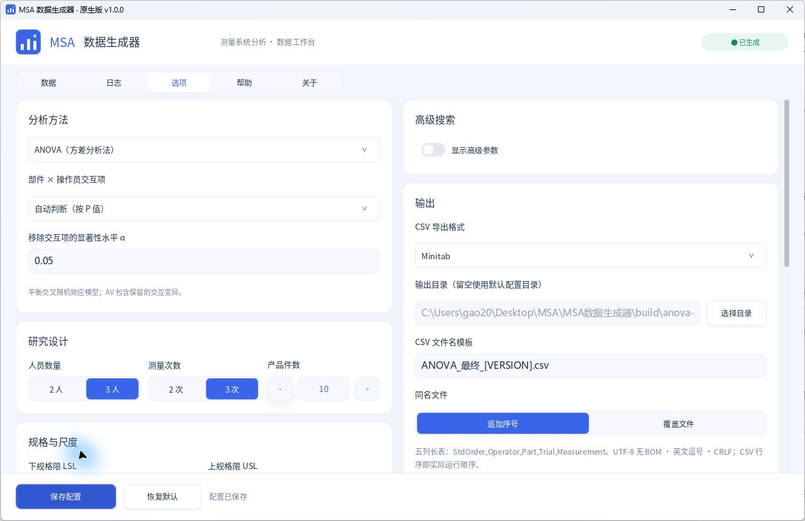
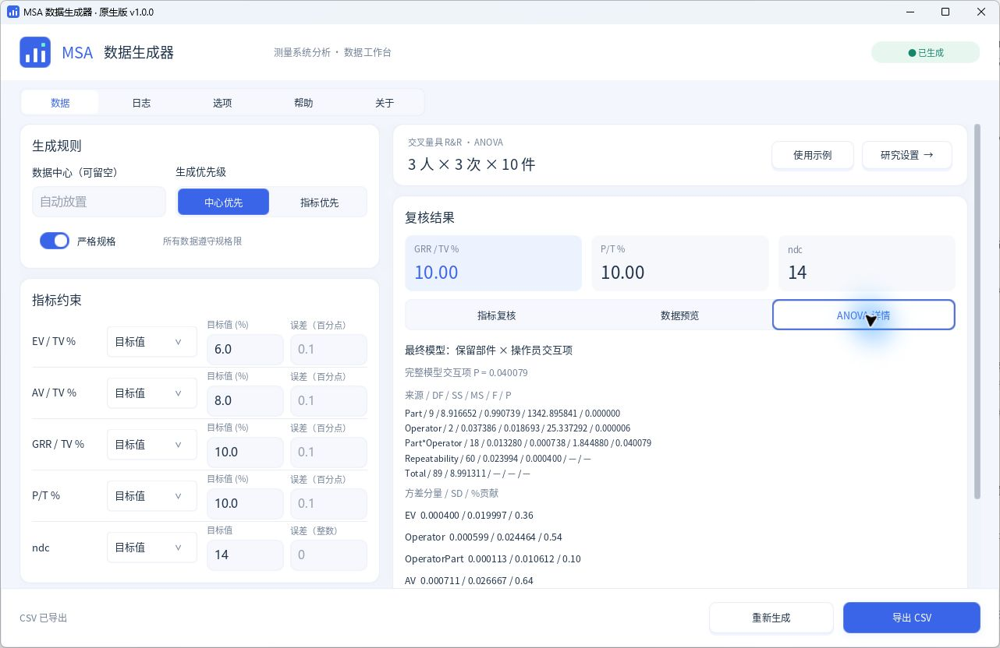

# 交叉量具 R&R：ANOVA 设计与五软件对标

## 使用方法

在“选项 → 分析选项 → 分析方法”选择 **ANOVA（方差分析法）**。默认方法为 Xbar-R（均值极差法）；配置缺少方法字段时使用该默认值。分析方法、交互项策略和显著性水平支持保存、启动加载、恢复默认及 CLI 覆盖。修改这些分析参数后需重新生成；导出设置仍独立，不要求重新生成。

```powershell
.\build\Release\msa_cli.exe --config examples\示例配置.json --method crossed_anova --interaction auto --interaction-alpha 0.05 --csv-format minitab --seed 123 --output anova.csv --report anova.json
.\build\Release\msa_cli.exe --config examples\示例配置.json --method crossed_anova --input anova.csv --report reanalysis.json
```

`--input`只分析既有宽表或长表，不生成、改写或自动导出 CSV；无需满足生成专用的规格/参考尺度前置条件，但设计尺寸须与数据相符。报告包含`analysis_only=true`及`seed=null`，不为输入数据编造生成种子。不能与`--output`合用，输入和报告不能同路径。指标约束只报告复核结果，不阻止分析不满足目标的输入。

GUI 结果区提供“ANOVA 详情”；CLI 报告的 `metrics.anova` 提供：

- `full_table`：含交互的完整 ANOVA 表；`table`：最终采用的模型表。
- `interaction_p`、`interaction_included`：完整模型交互 P 值及最终选择。
- `variance_components`、`stddev`、`study_variation`：方差、SD 及配置倍数×SD。
- `contribution_pct`、`study_variation_pct`、`tolerance_pct`：方差占比、标准差占比及容差占比。

EV、AV、GRR、PV、TV 继续使用 SD（1σ）；AV 包含操作员与保留的部件×操作员交互分量。原指标目标、文件名实际指标变量、CSV 复验、后台生成和取消均使用所选方法。

## 计算模型

适用于完整平衡交叉设计：每名操作员对每个部件进行相同次数的重复测量。本程序支持 2 或 3 名操作员、2 或 3 次重复测量、5～10 个部件。部件、操作员及其交互均按随机效应处理，采用 EMS 均方矩估计，不采用 REML 或 Bayesian 估计。程序为独立 C++ 实现，运行时不依赖五款对标软件。

令部件数为 P、操作员数为 O、重复数为 R。完整模型自由度分别为 P−1、O−1、(P−1)(O−1)、PO(R−1)；主效应 F 检验以交互均方为分母，交互 F 检验以重复性均方为分母。

| 方差分量 | 保留交互 | 移除交互 |
|---|---|---|
| 重复性 EV² | MS_Error | 合并后的 MS_Error |
| 操作员 | max(0,(MS_Operator−MS_Interaction)/(P×R)) | max(0,(MS_Operator−MS_Error)/(P×R)) |
| 部件×操作员 | max(0,(MS_Interaction−MS_Error)/R) | 0 |
| 部件 PV² | max(0,(MS_Part−MS_Interaction)/(O×R)) | max(0,(MS_Part−MS_Error)/(O×R)) |

移除交互时，将其 SS 和 DF 合并到重复性误差后重新计算 MS、F 和 P；不直接删除一行，也不将被截断的负估计重新分配。

- `interaction=auto`：完整模型交互 P<α时保留，P≥α时合并，默认α=0.05，与 Minitab 默认规则一致。
- `include`：始终保留；`exclude`：始终合并。α须满足 0<α<1。
- 0/0 的 F 及 P 不可计算；自动模式在交互 P 不可计算时合并误差。正数除以 0 时 F 无法表示为有限 JSON 数字，F 记`null`、P 记 0。零 TV 的百分比、零 GRR 的 ndc 不可计算，均不伪装为 0。
- AV²=操作员分量+交互分量；GRR²=EV²+AV²；TV²=GRR²+PV²。
- %Study Var=100×分量 SD/TV_SD；%Contribution=100×分量方差/TV 方差。双侧规格且未设置独立分析容差时，P/T%=100×研究倍数×GRR_SD/(USL−LSL)。ndc=max(1,floor(1.41×PV_SD/GRR_SD))。

以上为研究数据估计的基础口径。历史过程参数可改变 TV/PV 及相应百分比；独立分析容差和单侧规格另有 P/T 定义，详见[配置参考](配置参考.md)。不要将这些参数组合的输出直接套用基础公式比较。

ANOVA 生成器使用正交分解构造部件、操作员、交互及单元内残差，量化到指定小数位后再使用实际 ANOVA 分析、检查约束。未改动原 Xbar-R 候选构造与随机序列。

## 五软件实测结果

2026-10-25，共用 27 份 CSV：全部 24 种设计各一组生成数据，另加交互合并、显著交互及负操作员方差三个解析案例。最终模型中 20 组保留交互、7 组合并误差；每款软件处理同样的 1,185 条测量记录，共 135 次软件案例对照。三种运行顺序均有覆盖。

所有导入记录逐项核对测量值、操作员、部件、Trial 和 StdOrder；原生导入/回读值与源 CSV 双精度值相同，StdOrder 为完整 1～N 且对应关系正确。

| 软件与实测接口 | 计算口径 | 最大 SD 绝对差 | 最大%Study Var 绝对差（百分点） |
|---|---|---:|---:|
| Minitab 22.6，GAGERR/COM | 原生交叉量具 R&R ANOVA，默认α=0.05 | 2.03e-14 | 6.09e-12 |
| SPSS Statistics 32，VARCOMP+UNIANOVA | 双随机效应，Type III ANOVA/EMS；分别拟合完整与合并模型 | 3.84e-12 | 1.15e-9 |
| JMP 19，Fit Model/EMS | 部件、操作员及交互均设 Random；分别拟合完整与合并模型 | 3.82e-12 | 1.15e-9 |
| OriginPro 2026b / 10.3.5 | COM 工作表写入及精确回读，Origin 进程内原生 ocMath 双因素 ANOVA 接口 | 1.14e-14 | 6.36e-13 |
| MATLAB R2026b，anovan | random=[1 2]、Type III，完整与线性模型分别拟合 | 1.07e-14 | 1.07e-12 |

共 5,776 项数值检查通过，采用`abs(actual−reference) <= 1e-10 + 1e-8×abs(reference)`；ndc 及各来源 DF 要求完全一致。核对方差分量、SD、研究变异、%贡献、%Study Var、P/T、ndc、交互 P 和模型判定，并检查 ANOVA 表的 SS/DF 及 JMP、SPSS 最终随机效应表的 MS/F/P。

**比较范围：** Minitab 直接使用存储的量具 R&R 统计列。SPSS、JMP、MATLAB 及 Origin 的 ANOVA/方差分量为各软件原生计算结果；未提供相同量具汇总输出的项目，使用原生均方或分量按上表统一 EMS 公式派生 GRR、研究变异和百分比。Origin 验证不等同于在 Gage Study App 界面逐项操作；其固定效应 ANOVA 主效应 F 不直接与随机效应主效应 F 比较。本文没有宣称各软件默认选项、REML、Bayesian 估计、置信区间或图形结果全部相同。

SPSS 和 JMP 的原始 EMS 负分量仍保存在各自证据中；仅在统一量具口径汇总时逐项置零，与本程序和 Minitab 一致。原始估计的负号没有被修改。浮点末位差异不作为数据不一致，显示精度也不替代全精度核对。

27 组矩阵及外部参考结果固定在 `tests/fixtures/anova_software_baseline.json`，可离线复核。另有 72 组设计/交互策略生成测试、216 组随机导出回读、解析解、零/负分量及 F 分布检查；192 组 Xbar-R 基准独立验证。

## 重跑与证据

常规测试无需安装五款软件：

```powershell
cmake --build build --config Release --parallel 6
ctest --test-dir build -C Release --output-on-failure
```

实际软件对标入口为`tests/test_anova_software.ps1`，需要本机已授权软件及其统计组件。它使用隔离测试项目，不修改个人配置或参考 CSV。SPSS 用安装自带 Python；Origin 适配器限定本次验证的 10.3.5 原生接口，在 Origin 内置 Python 中运行，DLL 不复制、不随软件分发。

逐案例 CSV、原生 JSON、Minitab 命令/存储列、SPSS 原始 OMS、JMP 完整精度表、MATLAB 及 Origin 原生结果保存在本地验证目录，由`.gitignore`排除。可提交的外部参考矩阵用于回归，不能替代在其他软件版本上重新实测。现有 Xbar-R 历史对标记录仍绑定其各自被测二进制。

## 公式与接口参考

- [Minitab：交叉量具 R&R 方差分量公式](https://support.minitab.com/en-us/minitab/help-and-how-to/quality-and-process-improvement/measurement-system-analysis/how-to/gage-study/crossed-gage-r-r-study/methods-and-formulas/gage-r-r-table/)
- [Minitab：默认交互项移除规则](https://support.minitab.com/en-us/minitab/help-and-how-to/quality-and-process-improvement/measurement-system-analysis/how-to/gage-study/crossed-gage-r-r-study/before-you-start/example/)
- [IBM：VARCOMP](https://www.ibm.com/docs/en/spss-statistics/31.0.0?topic=reference-varcomp)
- [JMP：EMS 模型报告](https://www.jmp.com/support/help/en/19.2/jmp/ems-traditional-model-fit-reports.shtml)
- [MATLAB：anovan 随机效应及输出](https://www.mathworks.com/help/stats/anovan.html)
- Origin：本机`OriginC/System/ocStats.h`、`stats_types.h`及`OriginC/OriginLab/ANOVATwoWay.cpp`公开接口与原生调用；[Origin 双因素 ANOVA 说明](https://docs.originlab.com/origin-help/anova-crd/)。

本次最终构建证据：`build/anova-software-final/comparison.json`、`artifact-binding.json`。GUI 验收中 90 条 CSV 与 CLI 逐字节相同，配置保存、启动加载和恢复 Xbar-R 默认值均通过；单独 EXE 和空工作目录运行通过，个人配置保持不变。实际界面如下：





数值边界另验证：完全一致的人员/轮次小数记录产生严格零 GRR 且 ndc 不可计算；约 1e-12 的真实重复性保持为正，不使用固定阈值归零。并验证 0/10 位小数、5.15 倍研究变异、无双侧规格及分量 P/T 溢出拒绝。
