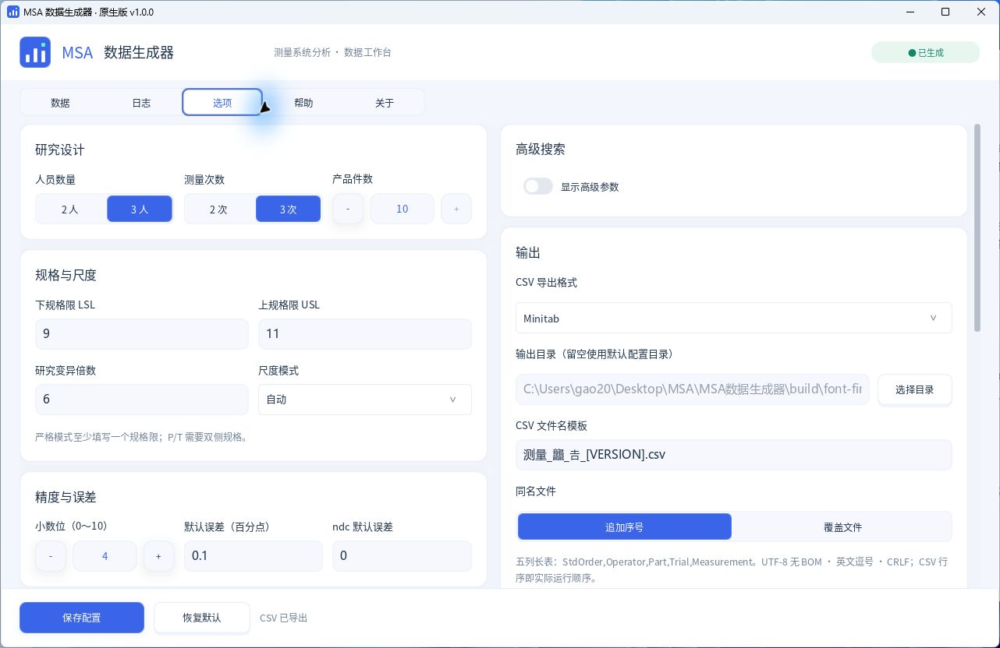

# v1.0.0 单文件运行验证

2026-10-25，使用最终异步预加载的 Windows x64 Release 构建验证 msa_generator.exe 的运行资源独立性。完整中文字体、应用图标及窗口清单内嵌于 EXE；字体以无损分块压缩的`MSA_FONT_NOTO_CJK` RCDATA 资源提供，启动阶段在后台并行解码到共享内存，再由 UI 线程注册和绘制，不产生临时字体文件。

本页是字体与单文件运行专项的历史验证记录，对应下列 SHA-256 标识的异步预加载构建，EXE 为 16,686,592 字节。该大小和哈希不代表后续重新构建的发布文件。自动化回归及优化前后性能对照见[字体优化与性能验证](字体优化与性能验证.md)。

## 实际窗口验证记录

| 核对项 | 本次结果 |
|---|---|
| 程序目录 | 仅含 msa_generator.exe，没有 resources、外部字体、CLI 或其他运行依赖文件 |
| 工作目录 | 使用与程序目录不同的空目录，且目录名包含中文 |
| 实际窗口 | 成功启动，中文界面和应用图标正常显示 |
| 数据生成与导出 | GUI 实际生成 3 人×3 次×10 件，共 90 条测量；按全部随机运行顺序导出含 StdOrder 的 Minitab 长表，标准序号完整 |
| 动态中文 | 文件名模板及实际导出名含罕见字`龘`和`𠮷`，显示和文件保存正常 |
| GUI/CLI 一致性 | 使用相同研究配置和实际种子执行 CLI，CSV 逐字节相同 |
| 临时资源 | 未释放字体文件；程序目录仍只需一个 EXE |
| 用户配置 | 使用独立测试配置，个人保存配置的 SHA-256 前后不变 |
| 资源内容 | 压缩资源 13,587,081 字节，恢复的完整字体 16,437,364 字节，与锁定原文件逐字节一致 |
| 字体行为 | 14、18、24、28 四种字号的中文度量及渲染像素与文件字体相同；错误输入、调用方存储释放及重复注册检查通过 |

被测主程序 SHA-256：

`C8411E4F5CBC3F75D117CC948FD45A6C1FC7BD8120C3A751C49C0FD06D6C9C56`

GUI 与 CLI 一致的 CSV SHA-256：

`B3F2CFE960EA07B67F83BF6CE5D82E6C32E3FF4CB6EFC79D93F05B55C0D2AB1E`

字体锁定 SHA-256：

`2C76254F6FC379FDDFCE0A7E84FB5385BB135D3E399294F6EEB6680D0365B74B`



## 复现与证据

启用桌面渲染测试后执行完整回归：

```powershell
cmake -S . -B build -A x64 -DMSA_BUILD_RENDER_TESTS=ON
cmake --build build --config Release --parallel 6
ctest --test-dir build -C Release --output-on-failure
```

其中`msa_embedded_resources_regression`读取源码字体作为独立对照，再在空工作目录中验证内存字体的字节、错误输入、内存生命周期、四字号度量及像素一致性；该对照文件只用于测试，不是主程序运行依赖。该专项构建的 7 项 CTest 全部通过；CLI 为 89 项、发布校验为 17 项。当前测试入口及其他阶段计数见[验证总览](验证报告.md)。

专项检查覆盖压缩容器损坏拒绝、完整字体解码、共享内存所有权、重复解码缓存、300 条度量记录触发逐出，以及包含罕见汉字和 emoji 的中文渲染。

真实窗口测试的复现步骤：将主程序单独复制到一个新建中文目录，从另一个空工作目录启动，使用独立的测试用户配置生成数据并导出；以相同研究参数和实际种子执行 CLI，逐字节比较 CSV，并检查程序目录及测试目录中没有解压字体。CLI 仅用于独立复核，不放在主程序测试目录中，也不是 GUI 运行依赖。

本次实际窗口报告位于`build/font-final-single-exe-b8cddc891f084f548fc421811f4ec8fe/verification.json`，确认罕见字文件名`测量_龘_𠮷_1.0.0.csv`、90 条记录、完整 StdOrder 和 GUI/CLI 逐字节一致；自动化内嵌资源报告为`build/embedded-test-output/embedded-resources.json`。临时数据和机器报告由`.gitignore`排除。

## 运行与分发边界

单文件运行表示主程序启动不再需要外部 resources、字体文件或随包 DLL；Windows 及支持 OpenGL 3.3 Core 的显卡仍为运行条件。用户配置和导出 CSV 继续按既定路径保存，不代表所有运行数据都写入 EXE。

运行包不携带外部 `resources/` 目录，随包提供 `licenses/`、`LICENSE`、`NOTICE` 和第三方声明；中文字体的 OFL 全文为 `licenses/Noto-OFL.txt`。单文件启动能力与分发时的许可义务是两回事：再分发应按 MIT 和各第三方许可保留适用的版权及许可通知。源码仓库包含原始字体、图标及清单，供从源码构建使用。v1.0.0 Release 仅手工上传 Windows x64 便携运行包，源码从仓库标签或 GitHub 自动下载入口获取。
