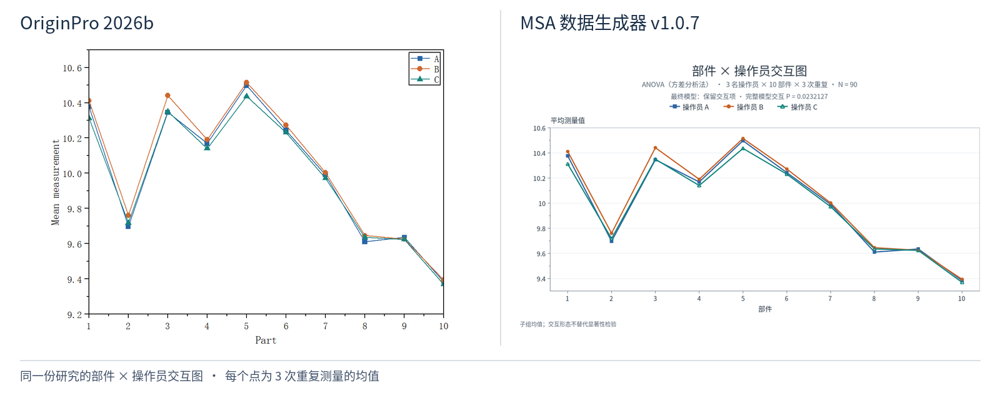

# 图表专项验证

图表验证覆盖 Xbar-R 和 ANOVA、24 种平衡交叉研究设计及七类图表。查看操作、编辑和导出设置请参见[结果可视化](结果可视化.md)。

## 图形口径

- 控制图明确采用传统合并平均极差口径，两种分析方法共用：重复次数 2/3 时 A2=1.880/1.023，D3=0，D4=3.267/2.574；均值图限值为总均值 ± A2×合并平均极差，极差图上限为 D4×合并平均极差。该三位小数常数口径未逐项对标所有软件的 ANOVA 控制限估计。
- 图形使用“操作员×部件”作为子组，Trial 仍表示真实重复测量编号。MATLAB 分析器可按连续记录建立子组；随机导出行序不能不经分组直接作为相同控制图比较。参见[MATLAB 分析器说明](https://www.mathworks.com/help/stats/gagerranalyzer-app.html)。
- 箱线图采用线性插值四分位数和 1.5 IQR 须线；与其他软件默认铰链算法、异常点/缺口定义可能不同。
- 柱顶数字为显示舍入，柱高沿用完整值；四类比例分别解释，不互相替代。百分比缺失或 TV=0 时不以虚构零值冒充结果。
- PDF 为单页高分辨率栅格图，不是可搜索文字或可编辑图元的矢量 PDF。

## 回归与文件回读

```powershell
cmake -S . -B build -A x64 -DMSA_BUILD_RENDER_TESTS=ON
cmake --build build --config Release --target msa_chart_tests msa_gui_layout_tests
ctest --test-dir build -C Release -R 'msa_(chart|gui_layout)_regression' --output-on-failure
python tests/test_chart_files.py --directory build/chart-test-output
```

- 图表模型回归检查数值映射、控制限、无效数据、图元和导出错误。界面回归检查草稿应用与撤销、错误恢复、切换数据源、组合导出和大小变化。
- 文件回读使用 Pillow 解码 PNG/JPEG，用 PyMuPDF 加载并渲染 PDF 和 SVG。SVG 另按 XML 核对面板、独立裁剪路径、可编辑文字和图元。报告保存在 `build/chart-test-output/`。
- 实际窗口验收时，从当前研究结果及 CSV 分别绘图，切换图表并编辑中文标题。检查无效草稿保留已应用的预览，导出单图和组合后，回读图像和 PDF。

## 共同数据对照

可用 CLI 生成含完整配置和测量矩阵的 JSON 报告，再传给图表测试程序生成共同数据的指标及图形。下面的 `study.json` 是程序报告路径。

```powershell
.\build\Release\msa_chart_tests.exe .\build\chart-test-output .\study.json
python tests/test_chart_files.py --directory build/chart-test-output
```

同一 CSV 在 MATLAB 中调用 `gagerr` 时，对齐交互模型、研究倍数和规格限。用 `tests/compare_chart_matlab.py` 比较程序的 `native-reference/crossed_anova_metrics.json` 与 MATLAB 导出的结果表。其他软件的图形参照和统计参数可从[GUI 参数兼容与对标](GUI参数兼容与对标.md)所列官方资料核对。

## OriginPro 2026b 实测



v1.0.7 的视觉对照使用固定研究。用 v1.0.6 的 CLI 导出一份 Origin 长表与 JSON，两边读取同样的 90 条测量值。研究含 3 名操作员、10 个部件，每人每件重复 3 次。运行下列命令可复现输入。

```powershell
.\msa_cli.exe --no-config --lsl 9 --usl 11 --seed 123 --method crossed_anova --csv-format origin --output measurements.csv --report study.json
```

| 核对项目 | 结果 |
| --- | --- |
| 文件与 ANOVA | Origin 工作表逐行读回全部 90 条记录。Origin 原生双因素 ANOVA 与程序的完整模型在平方和、自由度和适用的均方上一致，交互项 P 值均为 0.02321266。比较容差为相对 `1e-8`、绝对 `1e-10`。 |
| 操作员交互 | Origin 对每名操作员的每个部件求均值并连线。可在工程内选中曲线查看源工作表，或与程序 SVG 中的 30 个点核对。例如第 5 个部件的 A、B、C 均值分别为 10.497233、10.515300、10.436233。 |
| 测量值直方图 | Origin 自动分箱为 13 箱，箱宽 0.1。程序按这份样本的观测范围默认分 10 箱。工程另含按程序边界绘制的直方图，10 箱频数依次为 9、0、21、6、0、9、6、13、14、12。 |
| 控制图 | 按操作员和部件分组，按合并平均极差口径画图。极差图中心线为 0.05175333，均值图中心线为 9.99999667。Origin 参照图按子组顺序连接，程序将三位操作员并排分面。 |
| 变异分量 | 用 Origin 原生 ANOVA 的均方推导 GRR、EV、AV 和 PV，各自的研究变异占比、贡献率及公差占比共 12 项与程序一致。原生方差分析表与构图数据保存在工程内。 |

对照工程保留原始工作表和可编辑图层，发布附件另含 PNG 和本程序导出的矢量组合图。安装了 OriginPro 2026b 的用户可运行 `tests/origin/chart_reference.py` 重建工程。也可用 Python 运行 `tests/origin/verify_svg.py`，直接从 SVG 坐标轴、交互线段和直方柱核对已导出的图形数据。[下载工程与图表](https://github.com/print-yuhuan/Msa-Data-Generator/releases/download/v1.0.7/MSA_Origin_Reference_v1.0.7.zip)
